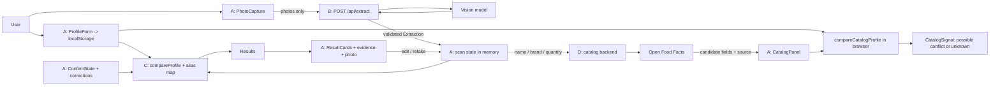

# LabelLens — Modular Design & Vibe-Coding Build Document
### Mission 76 · AIML · One-day hackathon · Team of 3
**Version 2.1 · 16 October 2026 · Expanded, one-day agent-assisted MVP · Team of 3**

---

## Table of Contents
1. Executive Summary
2. Scope Boundaries
3. Key Concepts Every Teammate Must Explain
4. How to Use This Document With Free AI Agents
5. High-Level Architecture and the Three Seams
6. Data Contracts (Profile, Extraction, Results, Alias Map, Catalog Extension)
7. Module Cards (A, B, C) and Planned Extension D
8. Matching Rules (the deterministic core)
9. Dashboard Specification
10. Trust and Accuracy Rules
11. Technology Stack and Windows Setup
12. Data Flow
13. Team Structure (3 people)
14. Sprint Plan With Integration Gates
15. Git Workflow and Integration Protocol
16. Demo Script and Success Metrics
17. Risks and Mitigations
18. Roadmap Beyond the Hackathon
19. Appendix — Fixtures, Golden Cases, Alias Starter, AGENTS.md, Test Label Set
20. Kickoff Prompts (one per module)

---

## 1. Executive Summary

LabelLens is an **evidence-first second look at a packaged-food label**. A user saves a small dietary profile, photographs the relevant package panels, and sees structured label details plus one of four honest answers — **Conflict, Possible conflict, No match found, Unknown** — tied to the exact words printed on the pack and shown beside the photo. The dashboard includes ingredients, allergen statements, visible nutrition facts, and package details when readable. Nutrition is displayed as printed, not turned into a health score.

The core product promise is one sentence: **AI can add doubt; only rules plus the user's own confirmation can add reassurance.** A vision model reads the photo. A deterministic rules engine decides every profile status. The user confirms panel completeness and fixes misreads. A separate product catalog can help identify a product, but never overrides what the photo does or does not show.

**Who it is for (first user):** a shopper, or a caregiver, avoiding one specific allergen while buying a packaged snack in India. A misread costs the most here, the decision is made in seconds, and "not listed" being mistaken for "safe" is the exact failure we prevent.

**Pressing issue:** in the shop aisle, a shopper must make a quick choice from small, curved, glossy print. They may miss an allergen alias or a "may contain" statement, while an unreadable or absent panel can be mistaken for a clear result. LabelLens makes the evidence and the unknowns visible at the decision moment.

### How the AI pieces converge

1. **Multimodal reading:** vision/OCR handles package photography and reports what it can and cannot read.
2. **Structured extraction:** the model organizes verbatim phrases into ingredient, allergen, nutrition, and package-detail fields.
3. **Reviewed vocabulary:** a small India-relevant alias map connects printed terms to canonical terms without rewriting the label.
4. **Deterministic comparison:** local rules compare those terms with the user's local profile and apply completeness gates.
5. **Human correction:** the user checks a quote against the photo, edits misreads, confirms panel completeness, or retakes a named panel.
6. **Separate catalog evidence:** optional product search helps identify a variant, but never upgrades a photo Unknown into a photo No-match.

The product advantage is the cooperation between uncertain image reading, explicit rules, reviewed terminology, and user verification. The LLM does not make the final dietary decision.

**What this document gives you:** a contract-first modular plan so each of the three people can build one module alone with an AI agent, using fixtures instead of waiting for teammates, and then integrate through only three small seams. Every module has a self-contained prompt (Section 20), a "done when" check you can run without reading code, and a mock mode so nothing blocks on anything else.

> LabelLens is not a medical tool, a food score, or a safety guarantee. It never says a product is safe.

---

## 2. Scope Boundaries

### In scope (the MVP)
- Responsive web app (phone, tablet, desktop browsers), English UI.
- Local dietary profile in browser `localStorage`: allergen presets (milk, egg, peanut, tree nut, wheat/gluten, soy, sesame, fish, shellfish), optional custom avoid terms, and diet (none / vegetarian / vegan).
- Upload or capture **1–3 photos** so ingredients, allergen, and nutrition panels can be separate when needed. One clear image is the simplest path.
- Vision extraction of ingredients, allergen statement (contains / may contain), nutrition values with units and basis when legible, product name/brand/quantity when visible, dates/batch codes as read, visible vegetarian/non-vegetarian marks, and per-section readability status.
- "Is this the whole list?" completeness confirmation by the user.
- Deterministic comparison against the profile → four-state result cards with evidence quotes shown next to the photo. Nutrition is displayed faithfully but is not compared with custom thresholds in the MVP.
- Edit a misread term → results recompute. Targeted retake prompt when a section is unreadable or partial.
- A small, reviewed ingredient alias map (India-relevant terms).
- After the photo → extraction → comparison flow is stable, let users type or correct product name, brand, and quantity when photo identity is missing. Show a separate catalog lookup with a heuristic 0–100 identity-similarity score, Strong / Possible / Weak band, matched/missing fields, and exact-variant confirmation. A catalog/profile match may raise a separate catalog warning, never rewrite the photo result or clear uncertainty.

### Next, only one at a time, only after Gate 3 (Section 14)
1. Manual barcode lookup only if a coverage check across 10 varied India-first products finds the correct product/variant and useful ingredient or nutrition data for at least 8. A hit is identity evidence, not proof of completeness or freshness.
2. Optional profile export/import, nutrition thresholds, or camera barcode scanning.

### Explicitly out of scope today
Accounts, profile/history synchronization, saved scan history, databases for the one-day MVP (SQLite/MongoDB/anything), nutrition thresholds, multilingual reading, an overall health score or grade, chatbot, product recommendations, online verification of dates/batch codes, regulatory or certification checks, OCR bounding boxes, per-ingredient confidence chips. SQLite is a later option only if synchronized profiles or saved history become a real requirement; SQLite alone does not provide cross-device sync.

**Cross-device requirement:** the web UI must work on phone, tablet, and desktop browsers. The MVP profile is saved separately in localStorage on each browser/device; it does not sync. Do not present responsive design as profile synchronization.

---

## 3. Key Concepts Every Teammate Must Explain

| Concept | One-line explanation |
|---|---|
| **Evidence** | For text, the exact printed words that support a result. For a package symbol, show a separate visual description and the photo; never present an AI description as a printed quote. |
| **Section status** | Whether a panel (ingredients, allergen statement, nutrition, or package details) was `readable_complete`, `readable_partial`, `unreadable`, `not_uploaded`, or `ambiguous`. |
| **Not listed vs. not detected** | "Not listed" = the label itself omits it. "Not detected" = we did not find it in what we could read. We can almost never prove the first, so we only ever say the second. |
| **No match found** | Always phrased "No match found in readable label text." Never "safe," never a green checkmark. |
| **Possible conflict** | Something needs the user's eyes: a "may contain" line, an ambiguous ingredient (e.g., "emulsifier," source not stated), an unreviewed alias, or a row the reader flagged. |
| **Unknown** | We could not read or confirm enough to check. Unknown is never reassurance. |
| **Model-estimated confidence** | A model's self-report. It is not a calibrated probability, and we do not show it as a number. We only use a simple `review_required` flag plus a reason. |
| **Catalog identity score** | Show a 0–100 heuristic identity-similarity score with a Strong / Possible / Weak band and the name, brand, or quantity fields that matched or were missing. It is not a probability and says nothing about whether catalog ingredient data is correct. |
| **Convergence rule** | Vision extraction, deterministic rules, and a separately labeled catalog signal work together. AI/catalog evidence may add doubt; neither can clear a product. Only rules + user-confirmed photo completeness can produce "No match found." |

---

## 4. How to Use This Document With Free AI Agents

This plan is built so you spend agent quota on building, not on re-explaining.

This minimizes coding and coordination work; it cannot remove the human steps. The team still needs to create the GitHub repository, obtain and protect the API key, photograph real packages, check the displayed label evidence, review alias mappings, and approve merges. Do not let an agent claim those checks were done unless a teammate actually did them.

1. **Commit `AGENTS.md` first** (text in Appendix 19.4). Most coding agents read it automatically, so you do not paste the project rules every time.
2. **One module per agent session.** Open a fresh session, paste: (a) your module's **card** (Section 7), (b) any contract sections it names (Section 6 or 8), and (c) the matching **prompt** (Section 20). Do not paste the whole document.
3. **Contracts are frozen files.** `shared/contracts.ts` and `backend/app/schemas.py` are created once, in the first 30 minutes, and are not edited by agents. If a change is genuinely needed, follow the contract-change protocol (Section 15).
4. **Fixtures first.** Every module runs against hand-written or recorded JSON until the real counterpart exists. Nobody waits for anybody.
5. **Record once, replay forever.** Live vision calls burn free quota. Run each test label through the real extractor once, save the JSON into `shared/fixtures/extraction/`, and use those files for everything else.
6. **Small asks, small diffs.** Ask the agent for one step at a time, and ask it to list changed files. Never ask it to "rewrite the whole file." Commit after each step that works.
7. **The agent proves its own work.** Every prompt ends with a check command. Paste the command output back into the agent if something fails. You are not expected to read the code.
8. **If an agent's quota runs out mid-task,** commit what works, then start the next free agent with the same module card and the line: "Continue; read existing files first."

---

## 5. High-Level Architecture and the Three Seams

```
                    ┌──────────────────────────── BROWSER ─────────────────────────────┐
                    │                                                                   │
  Person A          │   Profile form ─ Photo capture ─ Review ─ Result cards ─ Retake   │
  (UI)              │        │              │                         ▲                 │
                    │   localStorage        │ SEAM 1                  │ SEAM 2          │
                    └────────────────────────┼─────────────────────────┼─────────────────┘
                                             │ photos only             │ in-browser function call
                                             ▼                         │
  Person B          ┌───────────────────────────────────┐   ┌──────────┴────────────────┐
  (Reader)          │  FastAPI  POST /api/extract        │   │  compareProfile()          │  Person C
                    │  vision model → validated JSON     │   │  rules + alias map         │  (Judge)
                    └───────────────────────────────────┘   └───────────────────────────┘
                                   ▲                                      ▲
                                   └───── SEAM 3: both sides obey the same Extraction JSON ─────┘
```

**Three seams. That is the entire integration surface.**

| Seam | Between | Contract | Mock until ready |
|---|---|---|---|
| **1** | A ↔ B | `POST /api/extract` (multipart images) → `Extraction` JSON | A uses `shared/fixtures/extraction/*.json` (`VITE_EXTRACT_MODE=mock`) |
| **2** | A ↔ C | `compareProfile(extraction, profile, confirm, aliasMap) → Results` | C commits a stub on Day 0 that returns all `unknown` |
| **3** | B ↔ C | The `Extraction` JSON shape | C writes fixtures by hand; B's output must validate against the same shape |

**Privacy rule built into the architecture:** the profile never leaves the browser. The backend receives photos only and never sees the profile. The comparison runs locally in the browser.

---

## 6. Data Contracts

These are the only shared shapes. Prompt 0 (Section 20) turns them into `shared/contracts.ts` (TypeScript) and `backend/app/schemas.py` (Pydantic). They must match exactly.

### 6.1 Extraction (output of B, input to C)

```ts
type SectionStatus = "readable_complete" | "readable_partial" | "unreadable" | "not_uploaded" | "ambiguous";
type ImageQuality  = "good" | "blurry" | "cropped" | "glare" | "unusable";
type ImageRole     = "ingredients" | "allergens" | "nutrition" | "front" | "other" | "unknown";

interface SectionReading { status: SectionStatus; text: string | null; image_index: number | null; reason: string | null; }
interface SourcePhrase   { label_text: string; evidence_quote: string; image_index: number | null; }
interface ReviewablePhrase extends SourcePhrase { review_required: boolean; review_reason: string | null; }

interface IngredientRow extends ReviewablePhrase {
  id: string;                          // "ing-1", "ing-2", ...
  edited_by_user?: boolean;            // set by A when the user fixes a reading
  suggested_group?: { group: string; note: string } | null;  // UNVERIFIED model suggestion; max effect = possible_conflict
}

interface Mark {
  kind: "veg_mark" | "nonveg_mark" | "uncertain_diet_mark";
  visual_description: string;     // e.g. "green dot inside a green square"; not a text quote
  image_index: number;
  review_required: boolean;
  review_reason: string | null;
}

interface PackageFact extends ReviewablePhrase {
  kind: "product_name" | "brand" | "quantity" | "manufacture_date" | "best_before" | "expiry_date" | "batch_code";
  value_text: string;
}

interface NutritionRow extends ReviewablePhrase {
  id: string;
  nutrient: string | null;       // normalized display label when clear, else null
  amount_text: string | null;    // preserve the printed number as text; do not invent a number
  unit: string | null;           // e.g. g, mg, kcal; null when unreadable
  basis: string | null;          // per 100 g, per 100 ml, per serving, or null when not visible
}

interface Extraction {
  schema_version: "1";
  analysis_id: string;
  images: { index: number; role: ImageRole; quality: ImageQuality; note: string | null }[];
  product: { name: string | null; brand: string | null; quantity: string | null };
  package_facts: PackageFact[];       // evidence-backed photo readings; dates/batch are never verified online
  sections: { ingredients: SectionReading; allergen_statement: SectionReading; nutrition: SectionReading; product_details: SectionReading };
  ingredients: IngredientRow[];
  allergen_statements: { contains: ReviewablePhrase[]; may_contain: ReviewablePhrase[]; other: ReviewablePhrase[] };
  marks: Mark[];
  nutrition: NutritionRow[];           // display only in MVP; preserve the printed basis
  warnings: string[];
}
```

### 6.2 Profile (local to the browser; never sent to the backend)

```ts
type DietStyle = "none" | "vegetarian" | "vegan";
interface Profile {
  schema_version: "1";
  allergens: string[];     // keys from: milk, egg, peanut, tree_nut, wheat_gluten, soy, sesame, fish, shellfish
  custom_avoid: string[];  // free-text terms, exact matching only
  diet: DietStyle;
}
```

### 6.3 ConfirmState (what the user told us about this scan)

```ts
interface ConfirmState {
  ingredients_complete: boolean;           // user tapped "Yes, this is the whole ingredient list"
  allergen_statement_complete: boolean;    // user confirmed the allergen / may-contain line is fully visible
  pack_has_no_allergen_statement: boolean; // user says the pack has no allergen / may-contain line
}
```

### 6.4 Results (output of C, input to A's result cards)

```ts
type ResultStatus = "conflict" | "possible_conflict" | "no_match_found" | "unknown" | "not_applicable";

interface EvidenceItem {
  label_text: string | null;
  evidence_quote: string | null;  // text evidence; null for a visual mark
  visual_description: string | null; // visual evidence; null for a text phrase
  image_index: number | null;
  section: "ingredients" | "allergen_statement" | "marks";
  kind: "ingredient" | "contains" | "may_contain" | "mark";
  match_type: "exact" | "alias" | "ambiguous_term" | "unverified_suggestion" | "diet_term";
  mapped_to: string | null;   // canonical term the alias map points to, if any
}
interface ProfileResult {
  profile_key: string;        // e.g. "peanut", "diet_vegetarian", "custom:<term>"
  profile_label: string;      // e.g. "Peanut", "Vegetarian diet"
  status: ResultStatus;
  rule_id: string;            // "R1".."R7" from Section 8
  reason: string;             // one plain sentence for the card
  evidence: EvidenceItem[];
}
interface Results {
  schema_version: "1";
  items: ProfileResult[];     // already sorted: conflict, possible_conflict, unknown, no_match_found, not_applicable
  summary: Record<ResultStatus, number>;
  coverage: {
    ingredients: SectionStatus; allergen_statement: SectionStatus; nutrition: SectionStatus; product_details: SectionStatus;
    ingredients_confirmed: boolean; allergen_statement_checked: boolean; // checked = complete OR pack_has_no_allergen_statement
  };
}
```

### 6.5 Alias map (`frontend/src/domain/aliasMap.json`, owned by C)

```json
{
  "version": 1,
  "entries": [
    { "term": "groundnut", "group": "peanut", "kind": "alias", "canonical": "peanut",
      "scientific_name": null, "reviewed": false, "source": "UNVERIFIED - team to confirm", "note": "" }
  ],
  "diet_terms": [
    { "term": "gelatin", "applies_to": ["vegetarian", "vegan"], "reviewed": false, "source": "UNVERIFIED - team to confirm" }
  ]
}
```
- `kind`: `"exact"` (the allergen's own name), `"alias"` (another name for it), or `"ambiguous"` (could contain the allergen, source not stated).
- Only `reviewed: true` entries can produce a **Conflict** through an alias. `reviewed: false` entries can only produce **Possible conflict**. This keeps the demo honest until teammates verify each mapping.
- `scientific_name` stays `null` unless a trustworthy source is written in `source`. Never invent one.

### 6.6 Error envelope (B's API errors)

```json
{ "error": { "code": "bad_input | quota | provider_error | unreadable_response", "message": "plain sentence", "retryable": true } }
```

### 6.7 Optional catalog extension (Module D, only after Gate 3)

```ts
interface CatalogCandidate {
  source: "Open Food Facts";
  product_name: string | null; brand: string | null; quantity: string | null;
  identity_score: number; identity_band: "strong" | "possible" | "weak";
  matched_fields: string[]; missing_fields: string[];
  ingredients_text: string | null; allergens_text: string | null; nutrition_text: string | null;
  last_modified: string | null;
}
interface CatalogSignal {
  status: "catalog_possible_conflict" | "catalog_unknown";
  profile_key: string;
  matched_catalog_text: string | null;
  message: string; // must name catalog source and say to verify the current pack
}
```

Only after the user confirms the exact product/variant, the browser may compare catalog ingredient/allergen text with the local profile using the same explicit normalizer and reviewed alias map. **Every catalog hit stays `catalog_possible_conflict`**, even an exact term; a missing field or no catalog hit stays `catalog_unknown`. Never create `catalog_conflict` or `catalog_no_match_found`. Display source, identity score/band, match basis, available fields, and update date beside the raw catalog text. The profile remains in the browser. These signals are supplemental and do not modify `Results`, photo coverage, or photo-derived facts; disagreement prompts the user to inspect or retake the package panel.

---

## 7. Module Cards

Each card is the unit you paste into an agent session. Folders are owned: **never edit files outside your own folders.**

### Module A — The Face (UI, profile, review, correction)
**Person A.** **Owns:** `frontend/src/components/`, `frontend/src/pages/`, `frontend/src/styles/`, `frontend/src/api/`, `frontend/src/state/`.
**Does not touch:** `frontend/src/domain/`, `backend/`, `shared/`.
**Objective:** a polished, readable, responsive experience from profile to result, driven entirely by contracts.
**Inputs:** `Extraction` (from the API or a fixture), `Results` (from `compareProfile`). **Outputs:** photos to `/api/extract`; `Profile` to `localStorage`; `ConfirmState` to C's function.
**Builds:** the screens in Section 9, with a dev-only fixture picker (`?dev=1`) so every status can be seen without a backend. Include the extracted nutrition table and visible dates/batch codes as package facts, clearly marked "read from photo; not verified."
**Standalone run:** `npm run dev` with `VITE_EXTRACT_MODE=mock`.
**Done when:** with mock mode, you can pick each golden fixture (Appendix 19.2) and see the correct cards, evidence, nutrition rows, and "couldn't read" panel; the layout works at ~360 px, ~768 px, and ~1280 px wide; the profile survives a page refresh; an active scan clears on reset.

### Module B — The Reader (vision extraction backend)
**Person B.** **Owns:** `backend/app/extraction/`, `backend/app/main.py`, `backend/app/routes/`, `backend/.env.example`, `testset/`.
**Does not touch:** `frontend/`, `shared/contracts.ts`, `backend/app/schemas.py`.
**Objective:** turn 1–3 label photos into a valid `Extraction` that preserves wording, never guesses, and flags doubt.
**Inputs:** image bytes + MIME types. **Never receives the profile.** **Outputs:** `Extraction` JSON.
**Endpoints:** `GET /api/health`, `POST /api/extract` (multipart field `images`, 1–3 files).
**Modes:** `EXTRACT_MODE=live` (real vision call) or `mock` (returns a fixture).
**Extraction behavior (the prompt B gives the model):**
- Transcribe verbatim. Do not correct spelling, translate, summarize, or complete partly visible text.
- Report each section's status honestly (ingredients, allergen statement, nutrition, product details); `readable_partial` when cropped, `unreadable` when present but not reliably readable.
- Keep `contains`, `may_contain`, and `other` allergen phrases separate.
- Every text row (ingredient, allergen phrase, nutrition row, package fact) carries its exact `evidence_quote`, `image_index`, `review_required`, and `review_reason`. A package mark carries `visual_description`, `image_index`, and review fields; never invent a printed quote for a symbol.
- Extract nutrition values, units, and basis (for example per 100 g / per serving) only when visible. Preserve the raw phrase and mark uncertain rows for review; never infer a missing value or basis.
- Read product name/brand/quantity and dates/batch codes only when visible. These are photo readings, never online-verified facts.
- Report visible vegetarian / non-vegetarian symbols as `veg_mark`, `nonveg_mark`, or `uncertain_diet_mark` with a short `visual_description`; set `review_required` when the symbol is not clear. Do not turn the symbol description into text or make compliance claims.
- Optional `suggested_group` for an ingredient whose allergen group is not obvious; it is unverified and labeled as such.
- Output JSON only.
**Post-validation (code, not model):** validate against the schema; check text-row quotes against the matching transcript (`ingredients`, `allergen_statement`, `nutrition`, or `product_details` for package facts). If a quote is missing or the section transcript is unavailable, keep the row but set `review_required` with a reason; never repair or invent the quote. Marks are visual evidence; display the linked photo and model description, and require user review when unclear. Retry once on malformed JSON; map failures to the error envelope.
**Standalone run:** a CLI, `python -m app.extraction.cli <image> --out <file.json>`, plus the API with `curl`. The CLI is how you record fixtures.
**Done when:** the CLI turns at least 3 real photos into schema-valid JSON; clearly visible ingredient/allergen text and nutrition rows are retained with evidence; a deliberately blurry photo yields `unreadable` or `readable_partial` (not invented text); the mock mode works; the quote check flags a planted mismatch; a missing key returns a friendly error.

### Module C — The Judge (rules, alias map, fixtures, integration)
**Person C.** **Owns:** `frontend/src/domain/`, `shared/` (after the Day-0 commit, with the change protocol), `shared/fixtures/`, `scripts/`, `README.md`. **Integration owner:** reviews and merges PRs.
**Does not touch:** `frontend/src/components|pages|styles`, `backend/app/extraction`.
**Objective:** the deterministic core. A pure function, no network, no UI, that turns an `Extraction` + `Profile` + `ConfirmState` into `Results` according to Section 8.
**Builds:** `compareProfile`, the alias map, the golden fixtures with expected results, a check script, and the integration steps.
**Standalone run:** `npm run check:rules` (a Node script) prints one row per golden fixture: expected vs. actual status, PASS/FAIL.
**Done when:** every golden case in Appendix 19.2 passes; `unknown` is returned whenever a required condition is missing; no case returns `no_match_found` without all of R6's conditions; the contract validation script passes for all fixtures.

### Module D — Product-name catalog lookup (planned MVP extension, only after Gate 3)
**Owner:** C (or whoever is free). **Folder:** `backend/app/catalog/`, `frontend/src/components/catalog/` (agree with A first).
**Objective:** let the user enter or correct product name, brand, and quantity when the photo is incomplete or identity is uncertain; help identify an exact variant and show which fields an outside catalog has, kept visibly separate from the photo. This is the first feature to cut if the core flow is behind schedule.
**Rules:** triggered only by a button press, never search-as-you-type; max 5 candidates; user must confirm exact product/variant; show source, missing fields, and freshness when available; show a **0–100 heuristic identity-similarity score plus Strong / Possible / Weak band and match basis**. State clearly that it is not a probability and not a measure of ingredient-data accuracy. A catalog/profile match may raise a separate `CatalogSignal` only; catalog data never changes a section status, rewrites a photo result, or turns Unknown into "No match found."
**Scoring:** name similarity 60%, brand 20%, quantity/variant 10%, and market/country 10%; renormalize over fields actually supplied by the user. Text similarity is a heuristic. Initial display bands: 85–100 Strong, 65–84 Possible, below 65 Weak; these are demo thresholds, not validated probabilities. If only the product name is supplied, cap the band at Possible even when the name score is high. Example: "82/100 · Possible match · name and brand matched; quantity unknown." User confirmation is still required. Never title this a probability or a safety confidence.
**Go/no-go check before building:** try 3–5 of your actual India-first demo products manually for name search. If the records are mostly missing or wrong, skip the module and list it as a roadmap item. Before adding manual barcode lookup, check 10 varied India-first products across categories/brands; proceed only if at least 8 return the correct product/variant plus useful ingredient or nutrition data. Otherwise skip barcode. Camera barcode scanning is later.

---

## 8. Matching Rules (the deterministic core)

These rules are the specification for `compareProfile`. They are intentionally simple so an agent can implement and verify them.

**Normalization (comparison only):** lowercase, replace non-alphanumeric characters with spaces, collapse spaces, match on **whole-word / whole-phrase boundaries**, and allow a trailing "s." Never rewrite the displayed label text.

**Profile items evaluated:** each selected allergen, each `custom_avoid` term, and the diet (if not `none`).

**Candidate evidence sources:** each ingredient row's `label_text`; each `contains` phrase; each `may_contain` and `other` phrase; each mark.

| Rule | Condition | Status |
|---|---|---|
| **R1** | An **exact** term or a **reviewed alias** of the profile item appears in an ingredient row or `contains` phrase that is not `review_required`. | `conflict` |
| **R2** | A matching term appears in a `may_contain` or `other` phrase. | `possible_conflict` |
| **R3** | The match comes from an `ambiguous` map entry, an **unreviewed** alias, a row with `review_required: true`, or an unverified `suggested_group` equal to the profile item. | `possible_conflict` |
| **R4** | Diet: a clearly read `nonveg_mark` is present (both vegetarian and vegan) → `conflict`; an `uncertain_diet_mark` or mark requiring review → `possible_conflict`. A `diet_terms` entry applying to the user's diet appears in an ingredient → `conflict` if reviewed and the row is clear, otherwise `possible_conflict`. A `veg_mark` is shown as visual evidence but **never clears** a result or upgrades a status. | `conflict` / `possible_conflict` |
| **R5** | `custom_avoid`: exact phrase only (no alias map). In a clear ingredient or `contains` phrase → `conflict`; if that evidence row needs review → `possible_conflict`; in `may_contain`/`other` → `possible_conflict`. | `conflict` / `possible_conflict` |
| **R6** | **No hits at all**, AND `sections.ingredients.status == readable_complete`, AND `confirm.ingredients_complete`, AND (`sections.allergen_statement.status == readable_complete` with `confirm.allergen_statement_complete`, OR `confirm.pack_has_no_allergen_statement`), AND no ingredient or allergen-statement evidence row has `review_required: true`. | `no_match_found` (reason must say: "No match found in readable label text. This is not a safety check.") |
| **R7** | No hits and R6 is not satisfied. The reason names what is missing, in this priority: ingredients not uploaded / unreadable / partial / not confirmed complete; allergen line not checked; relevant evidence rows needing review. | `unknown` |
| **R8** | Precedence when several rules fire: `conflict` > `possible_conflict` > `unknown` > `no_match_found`. List **all** supporting evidence. A hit always wins over missing coverage. | — |

`not_applicable` is part of the type but unused in the MVP.

**Ordering of `Results.items`:** by status severity as listed in 6.4, then by profile order.

**User corrections:** when the user edits a term, A updates `label_text`, sets `edited_by_user: true`, and keeps the original in memory so it can be restored. When the user taps "I checked this row against the photo," A sets `review_required: false`. A then calls `compareProfile` again. A correction never upgrades a section's completeness.

---

## 9. Dashboard Specification

**Visual direction:** calm, consumer-friendly grocery helper. Light neutral background, strong typography, one restrained accent color, generous whitespace, large touch targets, visible keyboard focus. No overall health score, no decorative charts, no long AI-written prose.

**Quick design system:** warm canvas `#F7F6F2`, white surfaces `#FFFFFF`, dark ink `#202A28`, restrained teal accent `#147D64` for navigation and primary actions only. Use 8 px spacing steps, 14–18 px card corners, thin neutral borders, and one soft shadow level. Status colors: conflict `#B42318`, possible conflict `#9A6700`, unknown `#475569`, no match `#64748B`; pair every color with the specified text, icon, and border pattern. Do not use teal/green to imply safety. Use a clear system sans font, body text at least 16 px on mobile, and a visible focus ring.

### Layout
- **Phone (one column):** step strip → summary line → result cards → photo (collapsible) → ingredient review → "Couldn't read" box. A sticky bottom action for the next step.
- **Tablet:** two columns when each stays readable; otherwise stacked.
- **Desktop:** two-column workspace. Left: photo (sticky) and capture controls. Right: summary, result cards, ingredient review.

### Components (named so agents build them consistently)
| Component | Purpose |
|---|---|
| `StepStrip` | Profile → Photo → Results |
| `ProfileForm` | Allergen checkboxes, custom terms, diet; saves to `localStorage`; edit and clear |
| `PhotoCapture` | Camera capture where supported, always with file upload; add 1–3 photos, choose/remove/retake a panel. Before live upload, disclose which vision provider receives the image and link its data-use terms. Say only that LabelLens does not save the photo and that the profile stays in the browser; do not promise provider-side deletion or non-retention. |
| `ConfirmCompleteness` | "Is this the whole ingredient list?" and "Does the pack show an allergen / may-contain line?" |
| `CoverageSummary` | Counts by status plus coverage line, e.g. "Ingredients: read, you confirmed complete · Allergen line: not seen · Nutrition: partly read". **No overall verdict.** |
| `ResultCard` | Status badge, profile item, one-line reason, text quote or visual evidence, "show on photo" |
| `EvidenceQuote` / `VisualMarkEvidence` | For text, a quote block labeled "As printed", with the source badge "From your photo". For diet symbols, show a separate visual description and linked photo; never style the description as a printed quote. |
| `PhotoViewer` | The image; tapping an evidence item focuses/zooms the photo (no bounding boxes needed) |
| `IngredientTable` | Columns: As printed · Recognized as · Edit. Show a normalized/canonical term beside the printed term only when the alias map supports it; show a scientific name only when the reviewed map has a source. Only rows needing review are visually emphasized. Mapping tagged "reviewed" or "unverified suggestion". |
| `NutritionTable` | Display nutrient, printed value, unit, and serving basis. Preserve the evidence phrase; show unknown/not uploaded separately from zero. No health grade or threshold comparison. |
| `CouldntReadPanel` | Lists sections that are partial, unreadable, or not uploaded, with a targeted "Retake this panel" action |
| `SourceBadge` | "From your photo" / "Edited by you" / "From catalog — not your photo" |
| `CatalogPanel` (Module D) | Typed/prefilled product lookup, heuristic identity score, matched/missing fields, source/date, raw catalog text, and a separate catalog signal; never merges into photo ResultCards. |

### Status presentation (never color alone)
| Status | Label text | Icon shape | Border | Short reason pattern |
|---|---|---|---|---|
| Conflict | **Conflict** | Filled octagon with "!" | Solid, thick | "Label text matches your restriction." |
| Possible conflict | **Possible conflict** | Triangle | Dashed | "Needs your review." |
| Unknown | **Unknown** | Question-mark circle | Dotted | "We couldn't read enough to check." |
| No match found | **No match found** (full phrase in detail: "in readable label text") | **Neutral outline circle, no checkmark** | Thin solid | "Nothing matched in the text we could read. This is not a safety check." |

Cards are ordered by severity. Colors are consistent but supplementary, and meet readable contrast.

### Persistent copy
A small, always-visible note: "LabelLens reads label text. It can't confirm a product is safe. Check the pack yourself."

### States every view must handle
Loading (with progress text), empty (no profile / no photo yet), provider error (friendly message plus "try again" and "use a sample"), no allergens selected, unreadable photo. Before the first live upload, explain that the selected label photo is sent to the configured vision provider under that provider's terms; the profile remains local.

### Nutrition (mission baseline; display only)
A compact table that keeps printed units and serving basis; "not readable" is shown differently from a measured zero. Do not compare with custom diet thresholds in the MVP. If the nutrition panel is not in the uploaded photo set, show "Not uploaded" and invite the user to add that panel.

---

## 10. Trust and Accuracy Rules

| Situation | Rule |
|---|---|
| **Blurry photo** | The section is `unreadable`; nothing is inferred; the UI explains which panel to retake and how (flat, in light, closer, no glare). |
| **Partial / cropped panel** | `readable_partial`; "No match found" is blocked (R6); the cropped part is called out. |
| **Ambiguous wording** ("edible vegetable oil," "emulsifier," "natural flavours") | Row is shown as printed. If the alias map lists it as ambiguous for a profile item, result is `possible_conflict` with the quote. Do not map ambiguous terms to every allergen. |
| **Missing section** | `not_uploaded` is displayed explicitly. It is never blank, never green. |
| **Uncertain normalization** | Show the printed term. "Recognized as" appears only from the alias map; a model suggestion is labeled "unverified suggestion" and can only raise `possible_conflict`. Scientific names only with a stated source. |
| **Quote not found in transcript** | B sets `review_required` with a reason. Do not silently repair. |
| **User correction** | Marked "Edited by you"; original recoverable; rules re-run; dismissal of a flag stays visible. |
| **Catalog mismatch** | Show candidates and match basis; require exact-variant confirmation; label every catalog field with source/date. Any profile match is only a separate catalog-possible-conflict warning; missing data stays unknown; catalog never overwrites or clears photo facts. |
| **Dates / batch codes** | Shown as read. Never "verified." |

**Why the self-quote check is not enough:** checking a model's quote against the model's own transcription catches inconsistency, not misreading. The photo shown beside the quote, and the user's "I checked this row" action, are the real verification.

---

## 11. Technology Stack and Windows Setup

| Layer | Choice |
|---|---|
| Frontend | React + TypeScript + Vite + plain CSS (CSS variables); `lucide-react` icons optional |
| Backend | Python 3.12 + FastAPI + Pydantic + `python-multipart` |
| Vision | Gemini multimodal API first (free-tier model/account availability must be checked); called **from the backend only**. Keep GLM as a fallback only if needed. `GEMINI_API_KEY` and `GEMINI_MODEL` come from `backend/.env`. |
| Rules / alias map | Pure TypeScript function + a JSON file, in the browser |
| Catalog (planned extension) | Open Food Facts search through the backend; transparent heuristic match score only |
| Profile and scan state | `localStorage` for the small profile; browser memory for active analysis/photos, cleared on reset |
| Check scripts | Lightweight contract/rule checks plus manual real-label review |

**Database decision:** use localStorage for the small profile and in-memory state for a scan. No SQLite or MongoDB server in the one-day MVP. SQLite is sensible later for a deployed service with saved history or synced profiles, but SQLite by itself does not make a profile available across devices; that also needs a reachable API and an identity/consent plan. The required cross-device experience today is responsive browser UI, not profile sync.

No Docker, accounts, Redis, hosting, or second OCR vendor in the MVP. Verify the current model name, image support, free quota, and data-use terms in the vision provider's console on Day 0; availability and limits vary by model/account. Keep the model in an environment variable. The current Gemini free tier can be used to improve products, so disclose this to the team and send only cropped package-label images; never send the user's profile. A GLM key remains a fallback only if the first provider is blocked and the team accepts its terms.

### Official resources
- [Gemini API pricing and free-tier data-use notes](https://ai.google.dev/gemini-api/docs/pricing)
- [Gemini API image understanding](https://ai.google.dev/gemini-api/docs/image-understanding)
- [Gemini API structured output](https://ai.google.dev/gemini-api/docs/structured-output)
- [Open Food Facts API overview and data caveats](https://openfoodfacts.github.io/documentation/docs/Product-Opener/api/)
- [Open Food Facts Search-a-licious API reference](https://openfoodfacts.github.io/search-a-licious/users/ref-openapi/)
- [Open Food Facts product-by-barcode API v3](https://openfoodfacts.github.io/documentation/docs/Product-Opener/v3/products/get-api-v3-product-code/)

### Install (Windows, regular PowerShell, not Administrator)
VS Code, Python 3.12+, Node.js LTS, Git for Windows, a GitHub account, and a vision-provider API key. Verify:

- [VS Code](https://code.visualstudio.com/)
- [Python for Windows](https://www.python.org/downloads/windows/)
- [Node.js](https://nodejs.org/)
- [Git for Windows](https://git-scm.com/download/win)
- [GitHub](https://github.com/) — create an empty repository named `LabelLens` before cloning.
- [Google AI Studio](https://aistudio.google.com/) — create a Gemini API key only after checking current model access and terms. Keep it in `backend/.env`.
- [Gemini API docs](https://ai.google.dev/gemini-api/docs) — image input, structured output, pricing, quota, and data-use details.
- [Open Food Facts API docs](https://openfoodfacts.github.io/documentation/docs/Product-Opener/api/) — read/write distinction, attribution, data caveats, and rate limits.
- [Search-a-licious API docs](https://openfoodfacts.github.io/search-a-licious/users/ref-openapi/) — use only for the planned product-name lookup.
```powershell
py --version
node --version
npm --version
git --version
```

### Scaffold (Person C, Day 0 — or let Prompt 0 do it)
```powershell
git clone https://github.com/<TEAM>/LabelLens.git
cd LabelLens
mkdir backend, shared, scripts, testset
py -m venv backend\.venv
Set-ExecutionPolicy -Scope Process -ExecutionPolicy Bypass
.\backend\.venv\Scripts\Activate.ps1
pip install fastapi "uvicorn[standard]" python-multipart pydantic-settings google-genai httpx pillow
pip freeze > backend\requirements.txt
npm create vite@latest frontend -- --template react-ts
cd frontend; npm install; npm install -D tsx; cd ..
```
(The execution-policy change applies to that PowerShell session only.)

Root `.gitignore`:
```gitignore
.env
.env.*
!.env.example
.venv/
__pycache__/
*.py[cod]
node_modules/
dist/
*.log
.DS_Store
testset/images/
```
`backend/.env.example`:
```env
GEMINI_API_KEY=replace-me
GEMINI_MODEL=replace-with-model-you-verified
EXTRACT_MODE=mock
```
`frontend/.env.example`:
```env
VITE_EXTRACT_MODE=mock
```
Copy the examples to `.env` files ignored by Git. Set the backend and frontend modes to `live` only for a real provider call; the API key stays in `backend/.env` and never enters a `VITE_` variable.
Run:
```powershell
# terminal 1 (repo root, venv active)
uvicorn app.main:app --app-dir backend --reload --port 8000
# terminal 2
cd frontend; npm run dev
```
Vite proxies `/api` to port 8000 (set up by Prompt 0), so the browser never needs a key or a CORS workaround.

---

## 12. Data Flow



---

## 13. Team Structure (3 people)

| Person | Module | Also owns | Skills needed (beginner-friendly with an agent) |
|---|---|---|---|
| **A** | Face (UI) | Visual polish, responsive review, demo screens | Can judge "does this look and read well" |
| **B** | Reader (extraction) | The **test label set** and recorded fixtures, extraction accuracy report | Patience with photos and API keys |
| **C** | Judge (rules) | Contracts, alias map, golden cases, README, merges, final integration, demo script | Careful reading; likes checklists |

Each person is the only editor of their folders. C is integration owner because the rules engine touches both seams.

If one person falls behind, the cut order is: A drops extras (photo zoom), B drops retry logic, C drops custom-avoid terms — never the golden cases or the evidence display.

---

## 14. Sprint Plan With Integration Gates

(Times are from kickoff in a ~5.5-hour build; scale if your window differs.)

| Time | A — Face | B — Reader | C — Judge |
|---|---|---|---|
| **0:00–0:30** | Review module card; pick palette/typography | Verify API key and a single manual vision call; collect 8–10 real labels | **Prompt 0:** scaffold, contracts, stubs, fixtures stub, `AGENTS.md`; commit and push |
| **Gate 1 (0:30):** repo runs for everyone; contracts committed; every module has a stub with the right signature | | | |
| **0:30–2:00** | Build screens on fixtures (mock mode) | CLI extractor + schema validation + quote check; record first fixtures | `compareProfile` + alias map + golden check passing |
| **Gate 2 (2:00):** each module passes its own "done when" alone | | | |
| **2:00–3:00** | Wire `/api/extract` and `compareProfile` | API route live mode; fix errors found in integration | Integrate; run the whole flow on real labels |
| **Gate 3 (3:00):** photo → results works end to end on at least 3 real labels | | | |
| **3:00–4:30** | Correction, retake, confirm-completeness UX; responsive polish; loading/empty/error states | Tune extraction against the test set; accuracy tally | Edge cases; README; demo rehearsal outline |
| **Gate 4 (4:30):** feature freeze | | | |
| **4:30–5:30** | Stretch only if Gate 3 is solid and checklist is clean | Same | Record demo video; clean-clone test; publish repo |

**Hard cuts:** if there is no end-to-end flow by 3:00, drop barcode and any secondary catalog features; protect evidence, profile comparison, correction, nutrition display, and responsive polish. Product-name search is allowed only if at least 8 of 10 label cases give the expected states **and** a separate 3–5-product India-first catalog check finds useful records.

**Daily-style sync:** a 5-minute stand-up at each Gate (not every hour). The only things to say: what works, what is blocked, whether a contract change is needed.

---

## 15. Git Workflow and Integration Protocol

### Branches
`feat/a-ui`, `feat/b-extraction`, `feat/c-rules`. Optional later: `feat/d-catalog`.

### Rhythm
Commit a working checkpoint every 30–45 minutes and before switching tasks. Push after every commit. Open a small PR as soon as a usable slice works; C reviews and merges. Keep `main` runnable. Never force-push shared branches. Never commit `.env`, keys, or build output.

```powershell
git switch main
git pull --ff-only origin main
git switch -c feat/a-ui

git status --short
git add frontend/src
git commit -m "feat: add profile form"
git push -u origin feat/a-ui

# after a teammate's PR merges
git switch main
git pull --ff-only origin main
git switch feat/a-ui
git merge main
git push
```
Run `git status --short` before every commit and after every merge. Resolve conflicts together; never blindly choose "ours" or "theirs."

### Frozen files and contract-change protocol
`shared/contracts.ts`, `backend/app/schemas.py`, and `shared/fixtures/` are frozen after Gate 1.
1. Announce the change in the team chat and say which seam it affects.
2. C makes one PR changing the TypeScript contract, the Pydantic schema, and affected fixtures together.
3. Everyone merges `main` before continuing.
Agents must never "fix" a contract to make their own code compile — they fix their code.

### Integration steps (C drives, ~30 minutes)
1. **Seam 3 check:** `python scripts/validate_fixtures.py` validates every fixture with the Pydantic schema; `npm run check:rules` passes.
2. **Seam 1:** B sets `EXTRACT_MODE=live`; A sets `VITE_EXTRACT_MODE=live`; upload a real photo; confirm the response renders.
3. **Seam 2:** A replaces the stub import with the real `compareProfile` (the import path is identical, so this is usually already done).
4. Run the demo flow on all test labels; log wrong results in `testset/EXPECTED.md`.

---

## 16. Demo Script and Success Metrics

### 2–3 minute demo
1. **(0:20)** State the problem: tiny print, aliases, "may contain" — and that "not listed" is easy to mistake for "safe." Open the app at phone width; set the profile to one allergen plus a diet preference.
2. **(0:40)** A clear, real label where the allergen appears under an alias → **Conflict**. Tap the evidence quote; the photo focuses on the printed phrase.
3. **(0:30)** A label with a "may contain" line or an ambiguous ingredient → **Possible conflict**. Briefly show nutrition in its as-printed table and distinguish per-serving from per-100-g values.
4. **(0:40)** A deliberately cropped or blurry photo → **Unknown** and a targeted retake prompt. Retake; the result updates. Correct one misread term live.
5. **(0:20)** A clean label → confirm "this is the whole list" → "No match found in readable label text," and point to the line "This is not a safety check."
6. **(0:10)** Close: "AI reads. Rules decide. Unknown is never safe." Show catalog lookup only if it is stable.

Use 3–4 real products you checked in advance. Keep the saved photos and recorded JSON as a fallback in case of network or quota trouble.

### Success metrics (measure on your 8–10 test labels; these are targets, not promises)
- **Zero false "No match found"** on any test label that actually contains a profile item. This is the metric that matters most.
- Ingredient list transcribed correctly on most clear labels (record the count honestly).
- Visible nutrition values retain their printed value, unit, and basis; unreadable values stay unknown rather than becoming zero.
- Product/date/batch details include the exact printed evidence and are never described as verified.
- Every Conflict and Possible conflict shows a quote and a photo link.
- Every unreadable/partial/missing case ends as Unknown, never No match.
- Time from photo to result on a typical label (measure and report it; don't guess).
- Works at phone, tablet, and desktop widths with text and touch targets readable.

### Completion checklist
- [ ] Fresh clone starts from README on a teammate's machine.
- [ ] No key in the frontend or in Git.
- [ ] A real photo produces structured data and stays visible.
- [ ] Visible nutrition rows preserve unit and basis; absent/unreadable is not shown as zero.
- [ ] Dates and batch codes, if displayed, are labeled as read from the photo and not externally verified.
- [ ] A flag links to its evidence quote.
- [ ] Missing/unreadable → Unknown.
- [ ] "No match found" wording appears everywhere instead of "safe."
- [ ] Profile persists in `localStorage`; scan clears on reset.
- [ ] Golden check passes; fixture validation passes.
- [ ] If catalog was built: separate panel, source badge, confirmation required.
- [ ] README: setup, env vars, run, limitations, attribution, demo steps.
- [ ] Repo accessible to organizers; demo video recorded.

---

## 17. Risks and Mitigations

| Risk | Mitigation |
|---|---|
| Model misreads or completes text | Verbatim instruction, section status, quote check, user review, retake. Photo always visible. |
| False reassurance | R6's strict conditions; wording "No match found in readable label text"; golden cases that must not clear. |
| Free quota runs out | Record fixtures once; mock mode everywhere; keep a fallback provider seam; downscale oversized photos before upload but keep them readable. |
| Agent drifts from the contract | Frozen files, `AGENTS.md`, fixture validation script, C reviews every PR. |
| Agent quota exhausted mid-task | Commit often; restart with the module card and "read existing files first." |
| Alias map errors | `reviewed: false` default; unreviewed aliases can only raise Possible conflict; a teammate verifies each entry before flipping it. |
| Merge conflicts | Folder ownership; small PRs; one integration owner. |
| Catalog gives wrong/stale variant or ingredients | User confirms exact variant; show source/date and matched fields; catalog-only hits are always possible-conflict warnings; skip lookup if the pre-check fails. |
| Feature creep | Cut list in Sections 2 and 14; freeze at Gate 4. |
| Profile privacy | Profile stays in the browser; backend never receives it; no photos stored. |

---

## 18. Roadmap Beyond the Hackathon

Nutrition threshold comparison · product-name catalog lookup expansion and barcode lookup · a second independent reading of the same photo, with disagreement flagged for review · multilingual labels · profile export/import · saved history and cross-device sync (SQLite behind a deployed API, with consent and accounts as a separate phase) · bounding-box highlights on the photo · expanded and professionally reviewed alias map.

---

## 19. Appendix

### 19.1 Sample Extraction fixture (fictional product, hand-written)
```json
{
  "schema_version": "1",
  "analysis_id": "fixture-clear-peanut-alias",
  "images": [{ "index": 0, "role": "other", "quality": "good", "note": null }],
  "product": { "name": "Sample Masala Biscuits", "brand": null, "quantity": "120 g" },
  "package_facts": [
    { "kind": "product_name", "value_text": "Sample Masala Biscuits", "label_text": "Sample Masala Biscuits", "evidence_quote": "Sample Masala Biscuits", "image_index": 0, "review_required": false, "review_reason": null },
    { "kind": "quantity", "value_text": "120 g", "label_text": "Net quantity 120 g", "evidence_quote": "Net quantity 120 g", "image_index": 0, "review_required": false, "review_reason": null }
  ],
  "sections": {
    "ingredients": { "status": "readable_complete",
      "text": "Refined Wheat Flour (Maida), Sugar, Groundnut Oil, Milk Solids, Emulsifier (Soy Lecithin), Salt",
      "image_index": 0, "reason": null },
    "allergen_statement": { "status": "readable_complete",
      "text": "Contains: Wheat, Milk, Soy. May contain traces of tree nuts.",
      "image_index": 0, "reason": null },
    "nutrition": { "status": "readable_complete",
      "text": "Energy 450 kcal per 100 g; Protein 6 g per 100 g",
      "image_index": 0, "reason": null },
    "product_details": { "status": "readable_complete",
      "text": "Sample Masala Biscuits; Net quantity 120 g",
      "image_index": 0, "reason": null }
  },
  "ingredients": [
    { "id": "ing-1", "label_text": "Refined Wheat Flour (Maida)", "evidence_quote": "Refined Wheat Flour (Maida)", "image_index": 0, "review_required": false, "review_reason": null },
    { "id": "ing-2", "label_text": "Groundnut Oil", "evidence_quote": "Groundnut Oil", "image_index": 0, "review_required": false, "review_reason": null },
    { "id": "ing-3", "label_text": "Milk Solids", "evidence_quote": "Milk Solids", "image_index": 0, "review_required": false, "review_reason": null }
  ],
  "allergen_statements": {
    "contains": [{ "label_text": "Wheat, Milk, Soy", "evidence_quote": "Contains: Wheat, Milk, Soy", "image_index": 0, "review_required": false, "review_reason": null }],
    "may_contain": [{ "label_text": "tree nuts", "evidence_quote": "May contain traces of tree nuts", "image_index": 0, "review_required": false, "review_reason": null }],
    "other": []
  },
  "marks": [{ "kind": "veg_mark", "visual_description": "green dot inside a green square", "image_index": 0, "review_required": false, "review_reason": null }],
  "nutrition": [
    { "id": "nut-1", "nutrient": "Energy", "amount_text": "450", "unit": "kcal", "basis": "per 100 g", "label_text": "Energy 450 kcal per 100 g", "evidence_quote": "Energy 450 kcal per 100 g", "image_index": 0, "review_required": false, "review_reason": null },
    { "id": "nut-2", "nutrient": "Protein", "amount_text": "6", "unit": "g", "basis": "per 100 g", "label_text": "Protein 6 g per 100 g", "evidence_quote": "Protein 6 g per 100 g", "image_index": 0, "review_required": false, "review_reason": null }
  ],
  "warnings": []
}
```
(Ingredients list shortened for illustration; the full fixture lists every row.)

### 19.2 Golden cases (C implements; A uses them as the dev fixture picker)
Profile for all cases unless stated: allergens `peanut`, `milk`, `tree_nut`; diet `vegetarian`. `ConfirmState` shown per case.

| ID | Fixture situation | ConfirmState | Expected |
|---|---|---|---|
| G1 | Ingredient "Groundnut Oil"; alias `reviewed: true` | all confirmed | peanut → **conflict** (R1, alias) |
| G2 | Same, but alias `reviewed: false` | all confirmed | peanut → **possible_conflict** (R3) |
| G3 | "May contain traces of tree nuts" | all confirmed | tree_nut → **possible_conflict** (R2) |
| G4 | "Milk Solids" in a row with `review_required: true` | all confirmed | milk → **possible_conflict** (R3), not conflict |
| G5 | Ingredients `readable_partial`, no hits | ingredients_complete false | all items → **unknown** (R7) |
| G6 | Ingredients `not_uploaded` | none | all items → **unknown**; coverage shows not_uploaded |
| G7 | Clear label, no profile terms, allergen line readable | all confirmed | all items → **no_match_found** (R6), reason includes "not a safety check" |
| G8 | Same as G7 but `ingredients_complete` false | not confirmed | all → **unknown** (R7), never no_match |
| G9 | Same as G7 but allergen line not uploaded and pack-has-none not set | partial | all → **unknown**; reason names the missing allergen line |
| G10 | `nonveg_mark` present | all confirmed | diet_vegetarian → **conflict** (R4) |
| G11 | `veg_mark` present, ingredients contain `gelatin` (reviewed) | all confirmed | diet_vegetarian → **conflict**; the veg mark is shown but does not clear |
| G12 | Hit present but sections partial | not confirmed | hit's status wins over unknown (R8) |
| G13 | User edited a row from "Groundnut 0il" to "Groundnut Oil" | all confirmed | edited row counts; evidence shows "Edited by you" |
| G14 | "Emulsifier" with no source, alias map marks it ambiguous for soy; profile includes soy | all confirmed | soy → **possible_conflict** (R3) |
| G15 | Matching phrase in `contains` has `review_required: true` | all confirmed | matching allergen → **possible_conflict**, never conflict |
| G16 | `nonveg_mark` has `review_required: true` | all confirmed | diet_vegetarian → **possible_conflict**, never conflict |
| G17 | No matching term, but an ingredient or allergen evidence row still needs review | all confirmed | **unknown** (R7), never no_match_found |

Store expected results in `shared/fixtures/expected_results.json`. `npm run check:rules` must print PASS for all.

### 19.3 Alias starter (starter ideas only — every entry ships `reviewed: false` until a teammate verifies it)
- **peanut:** peanut, groundnut, arachis oil
- **milk:** milk, milk solids, skimmed milk powder, whey, casein, caseinate, butter, ghee, cream, curd, paneer, lactose (lactose may only warrant `ambiguous`; decide as a team)
- **wheat_gluten:** wheat, maida, atta, refined wheat flour, semolina (suji, rava), wheat gluten
- **soy:** soy, soya, soybean, lecithin (source not stated → `ambiguous`)
- **egg:** egg, albumen, egg powder
- **sesame:** sesame, til, gingelly
- **tree_nut:** almond, cashew, walnut, pistachio, hazelnut, pecan (use explicit nut names so words like "nutmeg" never match "nut")
- **fish / shellfish:** fish, anchovy; prawn, shrimp, crab
- **vegetarian diet terms:** gelatin, meat, chicken, fish, lard; **vegan adds:** milk, ghee, honey, egg, whey, casein (decide egg handling for vegetarian as a team; do not assume)
- **ambiguous examples:** "edible vegetable oil" (decide which groups, if any; keep the list short to avoid constant noise), "natural flavour," "emulsifier."

These are working ideas, not verified facts. Check each against reliable references before flipping `reviewed` to `true`.

### 19.4 `AGENTS.md` (commit at the repo root)
```
# LabelLens — rules for coding agents
Project: web app that reads a packaged-food label photo, compares it to a local dietary profile, and shows evidence + uncertainty.

NEVER:
- say or imply a product is safe. "No match found in readable label text" is the strongest allowed wording.
- send the user's profile to the backend or any external service.
- put API keys in frontend code or Git. Keys live in backend/.env only.
- show model confidence as a probability. Use review_required + a reason.
- let AI-derived data produce "No match found" or clear a product. Only compareProfile (rules) decides statuses.
- let catalog data overwrite or relabel photo-derived facts.
- add databases, accounts, new packages, or features not in the module card without asking.
- edit shared/contracts.ts, backend/app/schemas.py, or files outside your module's folders.

ALWAYS:
- preserve exact label wording (label_text / evidence_quote).
- preserve nutrition value, unit, and basis as printed; never fill a missing value or serving basis by guessing.
- treat dates and batch codes as photo readings, never verified facts.
- show status with text + icon, not color alone.
- keep functions small, files short, and comments minimal.
- run the module's check command after each change and report the result.
- list files changed at the end of every task.
- commit message format: "feat: ...", "fix: ...", "docs: ...".

Folder ownership: A = frontend/src/{components,pages,styles,api,state}; B = backend/app/{extraction,routes,main.py}; C = frontend/src/domain, shared/, scripts/, README.md.
Check commands: A: npm run dev (mock mode) | B: python -m app.extraction.cli <image> | C: npm run check:rules
```

### 19.5 Test label set protocol (Person B)
- Collect **8–10 real packaged products** you can physically check, mostly India-first. Include: a clear back panel; a curved/glossy pack; a small-print pack; a label with a "may contain" line; one with no allergen line; one deliberately blurry shot; one cropped shot.
- For each, write the truth by hand in `testset/EXPECTED.md`: the ingredient list as printed, allergen line, nutrition values/basis, visible product facts, and which profile items it matches. Prepare 8–10 if possible before the sprint; at least 3 real labels are needed for a credible demo. Golden rules cases check the comparison logic, not OCR accuracy.
- Photos live in `testset/images/` (git-ignored; share by cloud drive). Commit only the recorded `Extraction` JSON and `EXPECTED.md`.
- Tally after each tuning pass: transcription correct, wrong, partly wrong, and **any false clear** (a must-fix).

---

## 20. Kickoff Prompts

Paste order for every prompt: **`AGENTS.md` (or let the agent read it) → the module card (Section 7) → the contracts it names (Section 6 / 8) → the prompt below.**

### Prompt 0 — Scaffold, contracts, stubs (Person C, first 30 minutes)
```
Set up a monorepo for LabelLens. Structure:
  /frontend  React + TypeScript + Vite, plain CSS. Vite dev proxy: /api -> http://localhost:8000
  /backend   Python 3.12 FastAPI. backend/app/main.py with GET /api/health only for now.
  /shared    contracts.ts and fixtures/
  /scripts   validate_fixtures.py
  /testset   EXPECTED.md placeholder
  AGENTS.md  (I will paste the content)

Create, from the shapes I paste below (Sections 6.1-6.7):
1. shared/contracts.ts with all types, exported, including the frozen CatalogCandidate and CatalogSignal types from 6.7 (the catalog feature itself stays unimplemented until Gate 3).
2. backend/app/schemas.py with matching Pydantic models for Extraction and the API error envelope only. Profile, Results, and CatalogSignal stay TypeScript/browser-side; Module D owns any catalog API validation model when it is approved to start.
3. frontend/src/domain/compareProfile.ts: a STUB with the exact signature
   compareProfile(extraction, profile, confirm, aliasMap): Results
   that returns every profile item as "unknown". Plus an empty aliasMap.json of the 6.5 shape.
4. frontend/src/api/extract.ts: extractLabel(files): if VITE_EXTRACT_MODE=mock, return a fixture; else POST /api/extract.
5. shared/fixtures/extraction/clear_peanut_alias.json (use the sample I paste) and shared/fixtures/profile_example.json.
6. scripts/validate_fixtures.py: validates every file in shared/fixtures/extraction/ against the Pydantic Extraction model and prints PASS/FAIL per file.
7. backend/.env.example, frontend/.env.example with VITE_EXTRACT_MODE=mock, root .gitignore (I will paste), and a README.md with run steps for both servers.
Do not build any UI or real logic. Do not add packages beyond what is needed. Report files created and the exact commands to run both servers and the validation script.
```

### Prompt A — The Face (Person A)
```
Implement Module A only (card pasted). Read AGENTS.md first. Edit only frontend/src/{components,pages,styles,api,state}. Do not edit domain/, shared/, or backend/.

Build the LabelLens UI against the contracts in shared/contracts.ts:
- Three-step flow: Profile -> Photo -> Results, using the components and the status presentation table in Section 9.
- Profile: allergen presets, custom terms, diet; saved to localStorage; edit and clear.
- Photo: camera capture where supported plus file upload fallback; support 1–3 images, preview, remove, retake, and panel role if simple. Before live upload, disclose the configured vision provider and link its data-use terms; the profile stays local, and do not claim provider-side deletion. Call extractLabel() from src/api/extract.ts. Keep the active scan in memory only.
- ConfirmCompleteness: "Is this the whole ingredient list?" and the allergen-line confirmation (including "This pack has no allergen line").
- Call compareProfile(extraction, profile, confirm, aliasMap) from src/domain after every change; render Results as ResultCards sorted as returned. Text evidence uses an EvidenceQuote labeled "As printed" and "From your photo"; a symbol uses its VisualMarkEvidence description and linked photo. Add "show on photo" to focus the image.
- IngredientTable with As printed | Recognized as | Edit. Show a normalized/canonical term beside the printed term only when the alias map supports it; show a scientific name only with a reviewed source. Editing sets edited_by_user and re-runs the comparison. Every reviewable text row must show its quote/photo; each visual mark must show its description/photo; provide an "I checked this row" action that clears review_required while keeping edits and source evidence distinct.
- NutritionTable with printed nutrient, value, unit, and basis. Preserve the quote. Keep unknown / unreadable / not uploaded distinct from zero; do not add nutrition thresholds or scores.
- Show product name, brand, quantity, dates, and batch codes only when read from the photo; label those facts as photo-read and never as externally verified.
- If Module D is integrated, show catalog candidates and a separate CatalogSignal panel with identity score/band, match basis, missing fields, source/date, and exact-variant confirmation. Only catalog_possible_conflict or catalog_unknown is allowed; never let catalog data change a photo result.
- CouldntReadPanel with a targeted "Retake this panel" action.
- CoverageSummary shows counts and coverage only. No overall health verdict or health score.
- Status must use text + icon + border style, not color alone. "No match found" uses a neutral outline icon, never a checkmark, and the phrase "in readable label text" must appear.
- Add a dev-only fixture picker (?dev=1) that loads each file from shared/fixtures/extraction so every state can be seen without the backend.
- Responsive: one column on phones, two columns on wider screens; readable text, big touch targets, visible focus; handle loading, empty, error states.
- No health score, chatbot, accounts, or API keys in the frontend.

Done when: with VITE_EXTRACT_MODE=mock, every fixture in the picker renders the right cards and quotes at ~360, ~768, and ~1280 px wide; the profile survives a refresh. Report files changed and what to click to verify.
```

### Prompt B — The Reader (Person B)
```
Implement Module B only (card pasted). Read AGENTS.md first. Edit only backend/app/{extraction,routes,main.py} and testset/. Do not edit shared/contracts.ts or backend/app/schemas.py.

1. Create an Extractor interface and a Gemini vision-model implementation first. Read GEMINI_API_KEY, GEMINI_MODEL, and EXTRACT_MODE from backend/.env. Never hardcode keys or models. Never log keys or image bytes. Keep the provider interface small so GLM can be used only if Gemini access/quota blocks the demo; do not implement both providers up front.
2. Accept 1-3 images with MIME types; reject other types and oversized files with a bad_input error envelope (limits set in a config value).
3. Before the first live call, check the provider's current free-tier access, model availability, quotas, and data-use terms. Prompt the model to: transcribe verbatim without correcting, translating, or completing; report ingredients, allergen statement, nutrition, and product_details status (readable_complete, readable_partial, unreadable, not_uploaded, ambiguous) with a reason; keep contains / may_contain / other separate; give each ingredient, allergen phrase, nutrition row, and package fact an exact evidence_quote, image_index, review_required, and review_reason; preserve nutrition amount, unit, and serving basis only when readable; report product name/brand/quantity and visible dates/batch codes as evidence-backed package_facts; describe visible vegetarian / non-vegetarian symbols separately as veg_mark, nonveg_mark, or uncertain_diet_mark with image_index and review fields; set optional suggested_group only for non-obvious allergen groups; output JSON only. NEVER send any user profile to the model.
4. Validate the output with the Pydantic Extraction model. Compare text evidence_quotes with their matching section transcript (product_details for package facts); if missing or the transcript is unavailable, set review_required=true with a reason and do not edit the text. Marks are visual evidence, not quotes; keep their image index and description, with review_required=true when classification is unclear. Retry once on malformed JSON, then return unreadable_response.
5. Routes: GET /api/health; POST /api/extract (multipart field "images"). EXTRACT_MODE=mock returns shared/fixtures/extraction/clear_peanut_alias.json. Map provider quota errors to the quota error envelope (retryable).
6. CLI: python -m app.extraction.cli <image> --out <file.json> so I can record fixtures without the frontend.

Done when: the CLI converts 3 real photos into schema-valid JSON; a blurry photo returns readable_partial or unreadable (no invented text); a planted quote mismatch gets review_required; mock mode works; a missing API key returns a friendly error. Report files changed, env vars, run commands, and limitations.
```

### Prompt C — The Judge (Person C)
```
Implement Module C only (card pasted, plus Sections 6 and 8). Read AGENTS.md first. Own frontend/src/domain/, shared/fixtures/, scripts/, README.md. Do not edit frontend components or backend extraction.

1. Implement compareProfile(extraction, profile, confirm, aliasMap): Results exactly per rules R1-R8 in Section 8. It must be a pure function: no network, no UI, no storage. Sort items as specified. Fill the summary and coverage fields.
2. Implement normalization (lowercase, strip punctuation, whole-word/phrase matching, trailing "s" tolerance). Never change displayed text.
3. Build evidence items as either text evidence (`evidence_quote`) or visual mark evidence (`visual_description` + image index); never fabricate a quote for a mark.
4. Build aliasMap.json from the starter ideas in Appendix 19.3. Every entry has reviewed:false and source:"UNVERIFIED - team to confirm". Never invent a scientific_name. Use explicit tree-nut names so "nutmeg" never matches.
5. Create shared/fixtures/extraction/*.json (hand-written, fictional products) and shared/fixtures/expected_results.json for golden cases G1-G17 in Appendix 19.2. Add npm script check:rules that runs a Node script (tsx) printing, per case, expected vs actual status and PASS/FAIL.
6. Run scripts/validate_fixtures.py and keep every fixture schema-valid.
7. Rule of safety: no code path may return no_match_found unless every R6 condition holds. Add a short comment on that function stating the condition list.

Done when: npm run check:rules prints PASS for G1-G17 and fixture validation passes. Report files changed and the output of both commands.
```

### Prompt I — Integration (Person C, at Gate 2–3)
```
Integrate the three modules without deleting anyone's work. Inspect git status and the branches first.
1. Confirm shared/contracts.ts and backend/app/schemas.py still match. Run scripts/validate_fixtures.py.
2. Set EXTRACT_MODE=live in backend/.env and VITE_EXTRACT_MODE=live in the frontend env. Run both servers. Upload one real label photo and confirm the response renders as ResultCards with evidence quotes.
3. Verify the failure paths: a blurry photo ends as Unknown; a bad file type shows the friendly error; missing API key shows the friendly error.
4. Verify every place the UI says "No match found" also includes "in readable label text," and nowhere says "safe."
5. Fix only integration bugs (imports, env, request shape). If a contract change seems needed, stop and report it instead of editing the contract.
Report what passed, what failed, and the exact next fix per failure.
```

### Prompt D — Module D: product lookup (after Gate 3 and a name-search pre-check)
```
Implement the product-name catalog lookup as a separate feature. Read AGENTS.md first.
- Backend: GET /api/catalog/search?q=<name>&brand=<optional>&quantity=<optional>. From the backend, call the official Open Food Facts Search-a-licious API using its currently documented request method and fields (the API reference documents POST search). Run only on explicit button press. Return at most 5 candidates with product name, brand, quantity, source "Open Food Facts", which of [ingredients, allergens, nutrition] are present or missing, and last-modified date if available.
- Compute a 0–100 identity-similarity score from supplied fields only: name 60%, brand 20%, quantity/variant 10%, market/country 10%; renormalize across fields actually supplied. Also show Strong / Possible / Weak band and exactly which fields matched or were unavailable. Label it "heuristic, not a probability"; do not imply ingredient-data accuracy.
- Frontend: allow name/brand/quantity input, optionally prefilled from photo-read facts, and search only on an explicit button press. Show candidates in a separate panel with a visible "From catalog — not your photo" badge and a different border style. The user must select and confirm the exact product/variant before showing its catalog fields and separately labeled CatalogSignal as supplemental context.
- Return catalog ingredient, allergen, and nutrition text when present, with absent fields explicit and update date when available. Keep all catalog text in the separate panel.
- After exact-variant confirmation, compare catalog ingredient/allergen text with the profile locally in the browser. A match may create only a `catalog_possible_conflict` with the matched catalog phrase, source, score/band, and a "verify on current package" instruction. Missing text/no match becomes `catalog_unknown`; never create `catalog_conflict` or `catalog_no_match_found`.
- Catalog data must not change a section status, rewrite a photo result, overwrite photo-derived facts, or send the profile to the backend. If the catalog has fields the photo lacks, show them only as "Catalog lists: ..." and suggest photographing that panel.
- A not-found or error response must not break the scan. Respect the provider's attribution and rate limits; no automatic repeated searches.
- Only after name search works, test barcode lookup against 10 varied India-first packages across categories and brands. Add manual barcode entry only if at least 8 return the correct product/variant plus useful ingredient or nutrition data. Do not build camera barcode scanning in this module.
Report files changed, and how to test with a product that has no record.
```

---

*End of document. Freeze the contracts at Gate 1, let the three modules run on fixtures, integrate through three seams only, and protect the one rule that makes LabelLens worth building: AI can add doubt; only rules and the user can add reassurance.*
